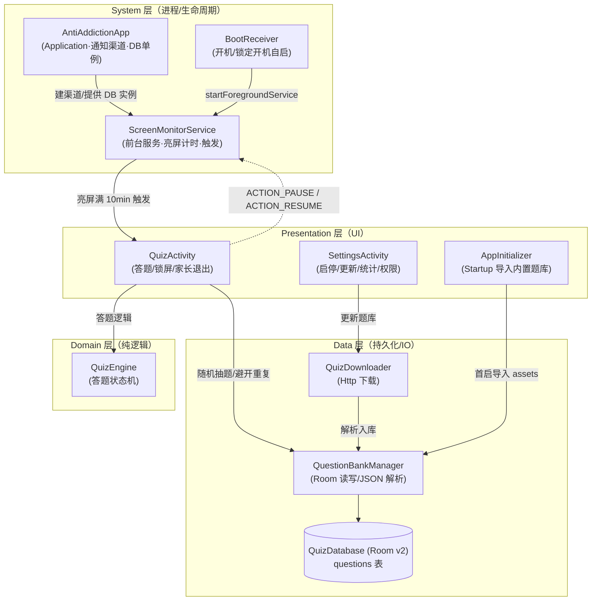
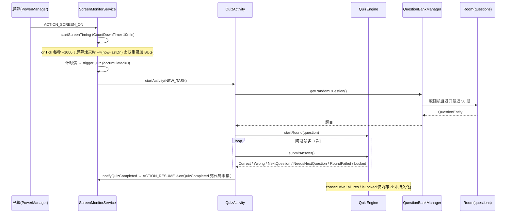

# AntiAddiction（学习守护 APP）架构评审与任务分解

> 评审人：高见远（Architect）｜范围：已实现的代码库（稳定 + 加固 + 增强路线图）
> 目标设备：华为 <phone-model>｜compileSdk/targetSdk=34，minSdk=24
> 技术栈：Kotlin 1.9.20 + Jetpack（Room 2.6.1、Coroutines 1.7.3、AndroidX Startup 1.1.1、ViewBinding、Material 1.11.0）

> 说明：本评审所有 12 条疑点均已**亲自读源码核对**（路径 `app/src/main/java/com/antidip/` 及 `app/build.gradle.kts`、`AndroidManifest.xml`、`README.md`）。核对结论在每一条中标注「已核实」。新增发现以「★ 新发现」标出。

---

## 1. 现状架构总览

### 1.1 四层职责划分

| 层 | 组件 | 职责 |
|---|---|---|
| **System（系统/生命周期）** | `AntiAddictionApp`、`BootReceiver`、`ScreenMonitorService` | 进程入口、开机自启、前台服务常驻、亮屏计时与触发、通知渠道、暂停/恢复状态 |
| **Domain（领域/纯逻辑）** | `QuizEngine` | 答题状态机：每题 3 次、追加题延迟、连续失败计数、锁定判定；不依赖 Android 框架，可单测 |
| **Data（数据/IO）** | `QuestionBankManager`、`QuizDownloader`、`db/*`（Room） | 题库导入（assets/本地目录/JSON 字符串）、随机抽题（避开最近 50 题）、按科目统计、Http 下载入库 |
| **Presentation（展示/UI）** | `ui/QuizActivity`、`ui/SettingsActivity`、`AppInitializer` | 答题/锁屏/家长退出 UI、设置与权限申请与统计、Startup 首启导入内置题库 |

### 1.2 组件关系图

### 1.3 核心数据流（亮屏 → 计时 → 触发 → 答题 → 引擎 → Room）

---

## 2. 风险与技术债清单

> 严重度：P0=阻断/严重（正确性或安全，发布前必修）；P1=重要（尽快）；P2=加固/整洁/局限。
>
> **阅读提示**：下表是**架构评审当时**发现的问题快照，用于记录风险来源，不代表当前仍未修复。除按用户决策明确保留的 #J（`allowBackup=true`）与少数 P2 整洁项外，P0/P1 问题均已在 §3 的各批次中完成；逐项修复状态请以 §3 表格与 §8 实施进度为准。表中已标注「已修复」的条目为后续补注。

### 已核实的 12 条疑点

| # | 标题 | 位置 | 影响 | 严重度 |
|---|---|---|---|---|
| 1 | **亮屏计时双重累加** | `ScreenMonitorService.startScreenTiming()` L120–144（onTick 每 tick `+=1000`，L136）；`pauseTiming()` L146–154（`+= now - lastScreenOnTimeMs`，L149–150） | 两种计时策略叠加：`lastScreenOnTimeMs` 记录的是「亮屏起点」而非「上次 tick 时刻」，屏幕熄灭时把整段亮屏时长又加一遍。实测亮屏 5 分钟被记成约 10 分钟 → 答题在约 5 分钟就触发，防沉迷节奏被腰斩且不可预测。 | **P0** |
| 2 | **死代码 `onQuizCompleted()`（**已由 B11 删除**）** | 原 `ScreenMonitorService.onQuizCompleted()` 定义但**全仓零调用** | 死代码已删除（B11）。真正的计时复位由 `QuizActivity.notifyQuizCompleted()` → `ACTION_RESUME` 完成；采用 B1 单一时间戳计时模型后，服务计时在「答对→RESUME 重启 10 分钟计时」路径正确，失败/惩罚路径无残留计时器，原"计时停摆"担忧已消除。 | P2（已修复） |
| 3 | **连续失败计数与锁定状态未持久化** | `QuizEngine` 字段 `consecutiveFailures`/`isLocked`（L32–33）由 `QuizActivity.quizEngine` 持有（L31） | 仅存于 Activity 内存。Activity 被回收/配置变更即清零，「连续 5 轮失败锁 10 分钟」这一核心防沉迷保证在进程死亡或旋转屏幕后失效，孩子可借此重置。 | **P0** |
| 4 | **家长万能密码硬编码（已由 B3 移出源码）** | 原 `QuizActivity.verifyParentPassword()` L295 `if (password == "<REDACTED>") return true` | 历史上源码字面量 + **README 曾写明**该密码；反编译或读文档即可绕过家长退出。**已由 B3 修复**：万能密码移出源码到 `local.properties`+`BuildConfig`，README 不再出现字面量。 | **P0（已修复）** |
| 5 | **`triggerQuiz()` 未取消在途 `quizTimer`** | `ScreenMonitorService.triggerQuiz()` L161–171 | 防御性不足：正常路径因 onFinish/remaining<=0 不会重复触发，但显式 `quizTimer?.cancel()` 更稳妥，避免边界下重复弹窗。 | P2 |
| 6 | **「锁机 10 分钟」仅为应用内 overlay**（**已由 B10 修复**） | `QuizActivity.showLockScreen()` L236–259 | 原未用 `DevicePolicyManager.lockNow()` 或屏幕固定（pinning），用户可用 Home/多任务脱离。B10 已加入：① 强制答题期间 `startLockTask()` 屏幕固定防脱离；② 设备管理员授权后惩罚真正 `lockNow()` 关屏（需解锁）。说明：在**孩子自有的设备**上，`lockNow()` 关屏后孩子仍可用自己的锁屏密码解锁——真正威慑来自"必须答对才能退出"的强制答题与屏幕固定；若家长另设孩子不知晓的设备密码，则完全硬锁。 | P2（已修复） |
| 7 | **下载 URL 硬编码局域网 IP 且为 HTTP** | `QuizDownloader.DEFAULT_URL` L16 `http://192.168.1.101:8080/questions.json` | UI 不可配置、无 HTTPS，且 HTTP 可被中间人篡改注入恶意题目入库（注入风险）；换服务器必须改代码重编。 | P1 |
| 8 | **全项目零测试** | 无 `app/src/test`、`app/src/androidTest`（已确认目录不存在） | `QuizEngine`（纯逻辑）与 `QuestionBankManager` 解析是高风险且高可测区域，无任何保护网，重构易回归。 | P2（价值高） |
| 9 | **常量跨模块字符串耦合** | `PREFS_NAME`/`KEY_SERVICE_PAUSED` 定义在 `BootReceiver` L33–34，被 `ScreenMonitorService`(L78–79,174,176)、`QuizActivity`(L279,281)、`SettingsActivity`(L54–57,74–77,120,123) 跨模块按字符串引用 | 易拼写错、难重构、含义分散；应集中到单一 `Constants`/`AppPrefs`。 | P1 |
| 10 | **release 用 debug keystore 签名** | `app/build.gradle.kts` L19–33：`local` config 指向 `${user.home}/.android/debug.keystore`（android/android）；release 用它签名（L31）；README L26–39 要求独立 `release` 配置 | release APK 用公开 debug 密钥签名，任何人都可重签/覆盖安装；与 README 描述不一致，违背发布规范。 | P1 |
| 11 | **`onActivityResult` 已废弃** | `SettingsActivity` L191、L203 调 `startActivityForResult`；L213–223 `@Deprecated` 重写 | 废弃 API，未来 Android 版本可能行为异常；应迁移到 Activity Result API。 | P1 |
| 12 | **`specialUse` 前台服务类型合规**（**已由 B13 说明**） | `AndroidManifest.xml` `foregroundServiceType="specialUse"` + `PROPERTY_SPECIAL_USE_FGS_SUBTYPE` | 侧载无碍（决策#3）；Play 上架需另行评估。B13 已在 §7 文档化，不阻塞。 | P2（已说明） |

### ★ 新发现（源码核对后补充）

| # | 标题 | 位置 | 影响 | 严重度 |
|---|---|---|---|---|
| K | **本地目录导入在 Android 11+(API30) 失效（Scoped Storage）** | `QuestionBankManager.importFromLocalDirectory()` L84–110 用 `getExternalStorageDirectory()`；`AndroidManifest.xml` L10–13 `READ_EXTERNAL_STORAGE` maxSdk=32、`WRITE_EXTERNAL_STORAGE` maxSdk=29 | 在 targetSdk=34 设备上，传统外部存储路径不可读，且 `file.renameTo(.processed)` 也失败 → README L96 承诺的「本地导入」功能在主流系统上静默失败。 | P1 |
| A | **`QuizActivity` 无 `configChanges`/`onSaveInstanceState`** | `AndroidManifest.xml` L27–32（QuizActivity 无 `configChanges`）；`QuizActivity.kt` 无状态保存 | 配置变更（旋转/深浅色）会重建 Activity，丢失当前题、剩余次数、锁定态——与 #3 叠加放大持久化缺口。 | P1（并入 #3 修复） |
| D | **题库耗尽时「轮失败」不累加 `consecutiveFailures`** | `QuizActivity` L210–212 `handleAnswerResult(AnswerResult.RoundFailed(quizEngine.consecutiveFailures + 1))` | 当题库不足无法追加下一题时，仅构造一个「+1」的展示结果，**并未真正自增引擎的 `consecutiveFailures`**，导致该路径永不计入锁定阈值，与引擎主逻辑不一致。 | P2 |
| J | **`allowBackup="true"`** | `AndroidManifest.xml` L20 | 允许 `adb backup` 提取应用数据（含 SharedPreferences）。密码不在 prefs 中故直接风险低，但属备份安全整洁项。 | P2 |
| F | **`onStartCommand` 冗余回读 `isPaused`**（**已由 B12 修复**） | `ScreenMonitorService` | 已删除 `onStartCommand` 末尾对 prefs 的冗余回读；改为在 `onCreate` 从 prefs 恢复暂停态（单一事实源），service 重启（START_STICKY）仍保留家长暂停决策。 | P2（已修复） |
| M | **`QuizDownloader` 连接未在 `finally` 关闭**（**已由 B12 修复**） | `QuizDownloader.downloadQuiz()` | 已改为 `connection` 声明在 try 外、`finally { connection.disconnect() }`，覆盖成功/非 200/异常全部路径。 | P2（已修复） |
| P | **`QuestionEntity` 无唯一约束** | `db/QuestionEntity.kt`；`QuestionDao.insertAll` 用 `REPLACE`（按自增 id） | `importFromJson`/下载重复执行会插入重复题目（自增 id 每次新建），题库膨胀。建议对 `(content, grade)` 加 UNIQUE 或去重。 | P2 |
| R | **Room `version=1` + `fallbackToDestructiveMigration`**（**已由 B14 修复：version=2 + `MIGRATION_1_2`**） | `db/QuizDatabase.kt` | 破坏性迁移已替换为正式 Migration（B14）；升级时按 `(content,grade)` 去重并新建唯一索引，不再清空题库。 | P2（已修复） |
| V | **`"accumulated_screen_time"` 字面量 key** | `ScreenMonitorService.saveState()` L177 | 与 #9 同类：应抽常量，避免拼写漂移。 | P2 |

---

## 3. 任务 Backlog

> 角色：PM=产品/主理人，Arch=架构，Eng=工程，QA=测试。工作量以「人·天」估算，不含联调/真机验证。

| ID | 标题 | 为什么 | 涉及文件 | 角色 | 优先级 | 工作量 |
|---|---|---|---|---|---|---|
| B1 | 修复亮屏计时双重累加 | #1 P0，节奏腰斩直接削弱防沉迷 | `ScreenMonitorService.kt` | Eng | P0 | 0.5d |
| B2 | 持久化连续失败计数与锁定状态 | #3 P0 + #A，核心保证不能随进程死而失效 | 新增 `data/QuizStateStore.kt`(DataStore)；改 `QuizEngine.kt`、`ui/QuizActivity.kt`、`AndroidManifest.xml`(configChanges) | Arch+Eng | P0 | 1.5d |
| B3 | 家长密码移出源码（保留两套口令） | #4 P0；用户决策#4：保留「日期倒写」动态口令 + 保留万能退出密码，仅将万能密码移出源码 | `ui/QuizActivity.kt`、`README.md`(删密码)、`local.properties`(gitignore)、`app/build.gradle.kts`(buildConfigField) | Arch+Eng | P0 | 0.5d |
| B4 | 集中常量到 `Constants`/`AppPrefs` | #9 P1，所有重构的基础，消除跨模块字符串耦合 | 新增 `Constants.kt`；改 `BootReceiver.kt`、`ScreenMonitorService.kt`、`ui/QuizActivity.kt`、`ui/SettingsActivity.kt` | Eng | P1 | 0.5d |
| B5 | 修正 release 签名配置 ✅ 已完成 | #10 P1，发布规范与安全 | `app/build.gradle.kts`、`local.properties`(环境变量注入)、`README.md` | Arch+Eng | P1 | 0.5d |
| B6 | 题库下载地址可配置 ✅ 已完成（HTTP） | #7 P1，避免 MITM 注入与硬编码 | `QuizDownloader.kt`、`Constants.kt`(DEFAULT_QUIZ_URL)、`ui/SettingsActivity.kt`(服务器卡片)、`res/values/strings.xml`、`README.md` | Eng | P1 | 1d |
| B7 | 迁移到 Activity Result API ✅ 已完成 | #11 P1，消除废弃 API | `ui/SettingsActivity.kt`（overlayPermissionLauncher/batteryPermissionLauncher + registerForActivityResult，删除 onActivityResult） | Eng | P1 | 0.5d |
| B8 | 修复本地目录导入（Scoped Storage）✅ 已完成 | #K P1，恢复 README 承诺功能 | `QuestionBankManager.kt`（`getExternalFilesDir` + IMPORT_DIR）、`getImportDirPath()`、`README.md` | Eng | P1 | 1d |
| B9 | 补充单元测试（仅单测）✅ 已完成（10 个用例已实跑通过） | #8 P2（高价值）；用户决策#7：不补 Espresso UI 测试 | 新增 `app/src/test/java/com/antidip/QuizEngineTest.kt`（覆盖答题状态机：正确/错误/追加题/需下一题/连续失败锁定/重置/延迟映射/答案归一化），并加入 `junit:junit:4.13.2` 依赖。`QuestionBankManager` 解析因与 Room 强耦合（需 Context+DB）暂未做纯单测，列为已知局限（需 Robolectric） | QA+Eng | P2 | 1.5d |
| B10 | 锁屏增强（真机锁屏）✅ 已实现 | #6 P2 + 用户决策#1：做真机锁屏，真实防脱离 | 双重机制：①**屏幕固定（lock task mode）** `QuizActivity.startLockTask()`，答题期间孩子无法用 Home/多任务脱离（已设设备锁屏密码时退出固定也需凭证）；②**设备管理员 `lockNow()`** 选配：设置页"启用设备管理器"授权后，连续答错惩罚会真正关屏，需解锁才能继续。新增 `AntiAddictionDeviceAdmin`/`DeviceLockHelper`/`res/xml/device_admin_policies.xml`、`AndroidManifest.xml` 注册 receiver、`SettingsActivity` 授权+状态+测试锁屏 UI、`README` 安装步骤补充 | Arch+Eng | P2 | 实现2d |
| B11 | 清理死代码与计时生命周期 ✅ 已完成 | #2 P2，理顺服务计时在「答对/答错/下轮」各路径 | 删除 `ScreenMonitorService.onQuizCompleted()` 死代码（QuizActivity 实际通过 `ACTION_RESUME` 复位计时）；确认单一时间戳计时模型（B1）下服务计时生命周期正确（答对→`ACTION_RESUME` 重启 10 分钟计时；失败/惩罚路径无残留计时器） | Eng | P2 | 0.5d |
| B12 | 安全/健壮性加固打包 ✅ 已完成 | #M/#F/#V/#5（#P/#R 随 B14 已完成；#J 按决策#5 保留 allowBackup） | #M `QuizDownloader` 连接改 `finally` 必断（含非 200 与异常路径）；#F `ScreenMonitorService` 删除 `onStartCommand` 冗余回读、改为 `onCreate` 从 prefs 恢复暂停态（单一事实源）；#5 `triggerQuiz()` 入口防御性 `cancel()` 在途计时器；#V 已在 B4 修复（`KEY_ACCUMULATED_SCREEN_TIME` 常量）；#J 按决策#5 保留 `allowBackup=true`（无敏感数据入库，无需 backupRules） | Eng | P2 | 0.5d |
| B13 | specialUse FGS 合规说明（侧载）✅ 已完成 | #12 P2 + 用户决策#3：分发已定侧载，specialUse FGS 无碍；仅文档说明，不做 Play 合规评估 | 见 §7 合规说明 | PM+Arch | P2 | 0.3d |
| B14 | 连续两次答对移出题库（✅ 已完成 2026-11-06） | 用户决策#8：一道题连续两次答对即从题库移除 | 已实现：`QuestionEntity.consecutiveCorrect` 列 + `(content,grade)` 唯一索引；`QuizDatabase` version=2 + `MIGRATION_1_2`；`QuestionBankManager.increment/reset/removeQuestion`；`QuizActivity` Correct/Wrong 分支接入 | Arch+Eng | P1 | 1d |

---

## 4. 依赖有序的实现序列

> 原则：先做「无依赖的基础重构（B4 集中常量）」，再修 P0 正确性与安全（B1/B2/B3），随后 P1 加固（B5–B8），最后测试与增强（B9–B13）。带依赖边见下方说明。

1. **B4 集中常量** — 无依赖，所有后续改动都引用单一常量源，最先做。
2. **B1 修计时双重累加** — 仅改 `ScreenMonitorService`，可在 B4 后独立进行（用集中后的常量）。
3. **B2 持久化连续失败/锁定** — 依赖 B4（用统一 prefs/DataStore 常量）；是 P0，紧跟 B1。同时补 #A 的 `configChanges` 与状态恢复。
4. **B3 密码外移** — 独立；可与 B2 并行（不同文件）。
5. **B5 修正签名** — 独立；与 README 对齐。
6. **B6 下载可配置+HTTPS** — 依赖 B4（URL 常量）；独立 UI。
7. **B7 Activity Result API** — 依赖 B4（SettingsActivity 已被 B4 改过），改同一文件，放在 B4 之后。
8. **B8 本地导入 Scoped Storage** — 依赖 B4（可选）；主要独立。
9. **B9 单元测试** — 依赖 B1/B2 完成（逻辑稳定后测试才有意义）；可先对未改动部分（QBM 解析）起步（用户决策#7：不补 UI 测试）。
9b. **B14 连续答对移出题库** — 依赖 B2（持久化/统计约定）与 #R Migration 规划（DB 升 version=2）；与 B12 去重/迁移同批做更高效。
10. **B10 锁屏增强** — 依赖 B2（锁定态已持久化才好做真锁屏）；**用户决策#1 已确认实施**，含设备管理员授权引导 UX（侧载无上架顾虑）。
11. **B11 死代码/计时生命周期** — 依赖 B2/B1 上下文清晰后进行。
12. **B12 加固打包** — 多文件整洁项，建议在 B4 之后统一收口。
13. **B13 合规说明（侧载）** — 分发已定侧载（决策#3），specialUse FGS 无碍，仅文档说明，精简处理。

依赖边（简图）：`B4 → {B1, B2, B6, B7, B8, B12}`；`B2 → {B9(部分), B10, B11, B14}`；`B1 → B9(部分)`；`B3/B5` 独立；`#R Migration 与 B12/B14 关联`。

---

## 5. 依赖与版本清单（核对自 `build.gradle.kts` / 根 `build.gradle.kts` / `gradle-wrapper.properties`）

### 构建工具链
| 项 | 版本 | 来源 |
|---|---|---|
| Android Gradle Plugin (`com.android.application`) | 8.2.0 | 根 `build.gradle.kts` L2 |
| Kotlin (`org.jetbrains.kotlin.android`) | 1.9.20 | 根 `build.gradle.kts` L3 |
| KSP (`com.google.devtools.ksp`) | 1.9.20-1.0.14 | 根 `build.gradle.kts` L4 |
| Gradle wrapper | 8.5 | `gradle/wrapper/gradle-wrapper.properties` |
| JVM target (Java/Kotlin) | 17 | `app/build.gradle.kts` L37–42 |
| compileSdk / targetSdk / minSdk | 34 / 34 / 24 | `app/build.gradle.kts` L9–14 |

### 运行库（app 模块）
| 库 | 版本 | 备注 |
|---|---|---|
| `androidx.core:core-ktx` | 1.12.0 | |
| `androidx.appcompat:appcompat` | 1.6.1 | |
| `com.google.android.material:material` | 1.11.0 | 与需求一致 |
| `androidx.constraintlayout:constraintlayout` | 2.1.4 | |
| `androidx.room:room-runtime` / `room-ktx` / `room-compiler`(ksp) | 2.6.1 | 与需求一致；DB version=2（随 B14 升级，含 `MIGRATION_1_2`），单例 |
| `org.jetbrains.kotlinx:kotlinx-coroutines-android` | 1.7.3 | 与需求一致 |
| `androidx.startup:startup-runtime` | 1.1.1 | 与需求一致 |
| `androidx.cardview:cardview` | 1.0.0 | 布局用 |
| `androidx.lifecycle:lifecycle-runtime-ktx` / `lifecycle-service` | 2.7.0 | 已引入但未在已读代码中深度使用 |

> 注：需求文档所述版本（Room 2.6.1 / Coroutines 1.7.3 / Startup 1.1.1 / Material 1.11.0）**与实际代码一致**，无需升级；Kotlin 实际为 **1.9.20**（非需求中隐含的旧版），AGP 8.2.0 + Gradle 8.5 组合可用。

---

## 6. 团队共享约定 + 待明确事项

### 团队共享约定（建议立即采用）
- **单一常量源**：所有 SharedPreferences 名/键、Intent action、计时/延迟常量集中到 `Constants.kt` / `AppPrefs`，禁止跨模块字符串硬编码（落实 B4）。
- **密钥与秘密**：任何密码/密钥不得进源码字面量或 README；走 `local.properties`(gitignore) + `BuildConfig` 字段或远端校验（落实 B3）。
- **网络**：题库下载地址必须在设置里**可配置**（禁止硬编码）；本地局域网部署允许 HTTP，公网地址须 HTTPS（落实 B6 + 决策#2）。
- **持久化**：跨进程/跨生命周期的状态（连续失败、锁定截止时间、暂停标志）必须落盘（DataStore/Room），不依赖 Activity 内存（落实 B2）。
- **测试基线**：纯逻辑（`QuizEngine`、JSON 解析）改动必须配套单测；CI 至少跑 `testDebugUnitTest`（落实 B9）。
- **发布**：release 与 debug 签名分离，release 密钥由环境变量注入，不入库（落实 B5）。
- **分支/提交**：P0 修复走独立 hotfix 分支，先合 `main` 再发版。

### 决策记录（用户已确认 · 2026-11-06）
> 原「待明确事项」已由用户拍板，相关任务据此调整；并新增第 8 条产品规则。

| # | 决策点 | 结论 | 对任务的影响 |
|---|---|---|---|
| 1 | 真机锁屏（设备管理员/屏幕固定） | **做** | B10 确认实施（侧载可授权设备管理员，无上架顾虑） |
| 2 | 题库服务器来源 | **本地部署**（LAN 服务器，沿用 `192.168.1.101:8080` 类地址） | B6 改为「下载地址可在设置里配置 + 本地局域网可用 HTTP」，HTTPS 非强制；B13 上架评估无需 |
| 3 | 分发方式 | **侧载**（sideload） | #12 specialUse FGS 侧载无碍；B13 仅需文档说明，不做 Play 合规评估 |
| 4 | 家长密码策略 | **保留「日期倒写」动态口令 + 保留万能退出密码**（原值已脱敏） | B3 改为：保留两套口令机制，仅把万能密码**移出源码**到 `local.properties`+`BuildConfig`（不再硬编码、不再写进 README） |
| 5 | `allowBackup` 云端备份 | **允许云端备份**（保持 `allowBackup=true`） | #J 关闭（无需改动）；可顺带补 `backupRules` 排除敏感项（可选，并入 B12） |
| 6 | 题库去重与版本升级 | **去重与版本升级策略关联** | #P（去重）+ #R（Migration）合并到 B12：导入按 `(content,grade)` 去重；DB 升 version 并写 Migration（不再 `fallbackToDestructiveMigration` 清空题库） |
| 7 | 是否补 Espresso UI 测试 | **不补** | B9 仅做单元测试（QuizEngine / QBM 解析），不做 UI 测试 |
| 8 | **新增产品规则** | **一道题连续两次答对 → 移出题库** | 新增任务 **B14**（见 §3）；需给 `QuestionEntity` 增加连续答对计数并做 Room Migration |

### 遗留/可选事项（非阻塞）
- 设备管理员撤回成本与 UX（B10 实施时需评估引导文案）。
- `backupRules` 是否排除非敏感数据（可选，并入 B12）。

---

## 7. 合规与分发说明（B13 · 侧载）

- **`specialUse` 前台服务类型**：`ScreenMonitorService` 声明 `foregroundServiceType="specialUse"` 并附 `PROPERTY_SPECIAL_USE_FGS_SUBTYPE`（说明文案："Screen monitoring for parental control anti-addiction"）。
  - **侧载场景（本应用分发方式，决策#3）**：无 Google Play 审核，可直接安装，无合规障碍。
  - **若未来上架 Google Play**：`specialUse` 需提交使用理由，且手表/儿童类应用受 Play 家庭政策约束，可能被拒；届时需评估改用受支持的前台服务类型或下架计划。**当前无需处理**。
- **设备管理员（B10）**：启用后本应用成为设备管理员，可调用 `lockNow()`。副作用：在系统"设置 → 安全 → 设备管理员"中会列出本应用，家长可随时撤销。**侧载无上架顾虑**，故直接实现而非回避。
- **`allowBackup=true`（决策#5）**：保留云端备份。应用 prefs 中**不含**万能密码（已移至 `local.properties`+`BuildConfig`），无敏感数据外泄风险；故未加 `backupRules`，列为可接受。

---

## 8. 实施进度（截至 2026-11-06）

| 批次 | 任务 | 状态 |
|---|---|---|
| Batch 1–2 | B1 计时双重累加、B2 失败/锁定持久化、B3 密码外移、B4 常量集中 | ✅ 已完成 |
| Batch 3 | B5 签名分离、B6 下载可配置、B7 Activity Result API、B8 Scoped Storage | ✅ 已完成 |
| Batch 4 | B10 真机锁屏（屏幕固定 + 设备管理员 lockNow） | ✅ 已完成 |
| Batch 5 | B11 死代码/生命周期清理、B12 健壮性加固（#M/#F/#5） | ✅ 已完成 |
| Batch 6 | B9 单元测试（QuizEngineTest）、B13 合规说明 | ✅ 已完成（10 个测试实跑通过） |
| Batch 7 | 工具链补齐 + 首次真实构建验证 | ✅ 已完成（`./gradlew testDebugUnitTest` 10/10 通过；`./gradlew assembleDebug` 成功产出 6.2 MB APK） |

### Batch 7 明细（补齐工具链并首次真实编译）

此前项目**缺少 Gradle wrapper**，代码从未真正编译，因此逐文件核对也无法发现编译期/运行期错误。本次补齐并实跑后，共修复以下隐藏缺陷：

| 类别 | 文件 | 问题与修复 |
|---|---|---|
| 构建脚本 | `app/build.gradle.kts` | `java.util.Properties` 在 Kotlin DSL 中未自动导入 → 补 `import java.util.Properties`；`create("debug")` 与 AGP 自带的 `debug` 签名配置重名 → 删除冗余定义，直接复用 AGP 默认调试密钥 |
| 工具链 | `gradle/wrapper/` | 生成 `gradlew`/`gradlew.bat`/`gradle-wrapper.jar`；`distributionUrl` 指向腾讯云镜像、`networkTimeout` 提到 60s，避免官方源超时 |
| 编译错误 | `data/QuizStateStore.kt` | 缺 `import androidx.datastore.preferences.core.edit` → 补上 |
| 编译错误 | `ui/QuizActivity.kt` | `setShowWhenLocked` 是 Activity 方法（非 Window、无对应 Kotlin 属性）→ 改为直接调用 `setShowWhenLocked(true/false)`；`isInLockTaskMode()` 在 android-34.jar 中不存在 → 改用本地 `lockTaskActive` 标志跟踪屏幕固定状态 |
| 编译错误 | `ui/SettingsActivity.kt` | `Intent(...).apply { }` 内 `this` 被 Intent 遮蔽，`DeviceLockHelper.component(this)` 传入了 Intent 而非 Context → 先捕获 `val context = this` |
| 编译错误 | `app/src/test/.../QuizEngineTest.kt` | `result` 是被 `repeat` 闭包捕获的 `var`，Kotlin 禁止 smart cast → 用不可变 `val` 快照 + 显式转换 |
| 运行错误 | `QuizEngine.kt` | 领域层调用了 `android.util.Log.d`，JVM 单测抛出 `Method d not mocked` → 移除 Log 依赖，使其成为真正的纯 Kotlin 类（与 §1.1 分层约定一致），日志由 UI 层承担 |
| 逻辑缺陷 | `QuizEngine.normalizeAnswer()` | 填空题注释承诺"忽略标点"，但实现只做全角→半角替换 → 增加标点去除，使 `"你 好。"` 正确匹配 `"你好"` |
| 测试预期 | `QuizEngineTest.kt` | Q1 耗尽但 Q2 未加载时引擎返回 `NeedsNextQuestion` 而非 `NextQuestion` → 修正断言 |

> 结论：`./gradlew testDebugUnitTest`（10/10 通过）与 `./gradlew assembleDebug`（BUILD SUCCESSFUL，`app/build/outputs/apk/debug/app-debug.apk`）均已实测通过；源码改动不再仅是"逐文件核对"，而是经过编译器与测试实际验证。

---

*本评审为已落地代码库的「稳定 + 加固 + 增强」路线图，非从零搭建。结论基于源码核对，并已由 `./gradlew testDebugUnitTest` 与 `./gradlew assembleDebug` 实际编译、测试验证。*

---

## 9. Batch 2-b / 2-c 增量记录（2026-11-08）

### 9.1 Batch 2-b（已完成，基线 101 JVM 单测全绿）

| 项 | 内容 |
|---|---|
| `ParentAuth.kt` | 统一家长口令（纯 JVM 4 参 `verify` + Android 包装 + 不可取消验证对话框）；`password.trim()`、`BuildConfig.MASTER_PASSWORD`、`Calendar + Locale.ROOT` 日期倒写 |
| M5 | `setLockScreenVisibilityCompat(enabled)` 成对管理 SHOW/TURN/KEEP 三组 flag；`DeviceLockHelper.lockNow()` 返回 false 时立即回滚 |
| A04 | `getRandomQuestionOrFallback()` 内存兜底，空题库不再 `finish()` 放行 |
| M3 × B14 | 去掉 `getTotalCount()>0` 导入守卫后，用 `KEY_MASTERED_FINGERPRINTS`（`grade|content.hashCode()`）阻止已掌握题在冷启动重导时复活 |
| T12 | `resumeTiming()` 在 `WAITING_QUIZ_RESULT` 态守卫，防止设置页「启动服务」绕过当前答题 |
| 测试 | 新增 35 个 `Batch2*Test`（ParentAuth 16 / QuizEngineExhausted 8 / UrlValidator 11），基线合计 **101 tests / 0 failures / 0 errors** |

### 9.2 Batch 2-c 家长控制台（三项可配置能力）

**设计决策（已采信）**

| 决策 | 理由 |
|---|---|
| 保留 `Constants.QUIZ_INTERVAL_MS` 作默认常量，新建 `AppConfig` 作配置单一事实源 | `Batch1ScreenTimingModelTest` 有 8 处引用，直接改常量会编译崩 |
| 间隔范围 1–60 分钟，`AppConfig` 二次钳制 | 真机可用 1 分钟快速验证 |
| 前台检测 `UsageStatsManager.queryEvents` 取最后 `ACTIVITY_RESUMED`（API 29）/ `MOVE_TO_FOREGROUND`（API 21–28），15 秒窗 + `queryUsageStats` 兜底 + AppOps 判权 | 短窗口避免「刚离开前台仍算命中」 |
| **fail-closed**：未授权 / 无数据 / 异常一律照常出题 | 否则孩子拒绝授权即可彻底关闭防沉迷 |
| 例外守卫必须在 `triggerQuiz()` 改状态之前 | 命中时保持 `IDLE`、绝不写 `quizInProgress=true`，否则服务永久等结果 + START_STICKY 幽灵重弹 |
| 保存间隔只 cancel timer 重算 remaining，保留 `screenOnStartMs` 与累计值，**绝不调 `pauseTiming()`** | 防止保存配置白送一个全新间隔 |
| 年级选项固定 1–6 + `ALL_GRADES(-1)`，默认 `ALL_GRADES` | 不能只取 `getAvailableGrades()`（内置全是 4 年级） |
| 年级版 `avoidingRecent` 直接砍掉，只保留 `getRandomQuestionByGrade()` 单级 | 小年级子集上 `NOT IN (全库最近 50 题)` 会恒退化 |
| 应用列表 `queryIntentActivities(MAIN+LAUNCHER)` + `<queries>`，不用 `QUERY_ALL_PACKAGES` | 最小权限 |
| `ConsoleActivity` `exported=false`、无 intent-filter、每次 `onResume` 重新验密、验证前不渲染布局 | 防返回键 / 多任务绕过；不启用 `excludeFromRecents` |

**落地文件**：新增 `AppConfig.kt` / `ForegroundAppDetector.kt` / `ui/ConsoleActivity.kt` / `ui/AppPickerAdapter.kt` / `res/layout/activity_console.xml` / `res/layout/item_exempt_app.xml`；修改 `Constants.kt` / `AndroidManifest.xml` / `db/QuestionDao.kt` / `QuestionBankManager.kt` / `ScreenMonitorService.kt` / `ui/QuizActivity.kt` / `ui/SettingsActivity.kt` / `activity_settings.xml` / `strings.xml` / `app/build.gradle.kts`。

### 9.3 API 29 真机评审结项

详见 `docs/api29_device_review.md`。结论：**无阻断性运行时兼容缺陷**；`foregroundServiceType="specialUse"` 在 API 29 不阻塞、BAL 弹题通道可用、通知渠道正常；设备管理员与屏幕固定属能力边界已文档化；`POST_NOTIFICATIONS` 在 API 29 不适用。UsageStats 当前为**未授权态**（`appops get com.antidip GET_USAGE_STATS = No operations`），正是 2-c fail-closed 的验证前置。

补充真机实测：`am force-stop` 与 `am kill` 后该 EMUI 设备**未自动恢复**进程/服务（`dumpsys activity services` 为空）。这是 Android「stopped state」+ EMUI 后台管理的共同结果，`START_STICKY` 仅保证系统因资源回收而杀死进程时的重建，**不保证**用户显式强杀/未加入自启动白名单时恢复。产品侧需在 README / 设置页引导家长把应用加入自启动与电池白名单，不能把「强杀后必自动恢复」写进承诺。

### 9.4 逐项验收矩阵（2-c）

| # | 验收点 | 方式 |
|---|---|---|
| A1 | 控制台需密码进入；错误密码不 dismiss；取消/返回后配置区仍隐藏 | 真机 UI |
| A2 | 间隔设 1 分钟，约 1 分钟后弹题 | 真机 logcat `ScreenMonitorService` |
| A3 | 保存间隔不重置累计时长 | 代码路径 + logcat |
| A4 | 年级 1–6 选项显示真实题量；选 0 题年级回退全库真实题 | 控制台 + 答题页 |
| A5 | 应用列表可读、可搜索、可多选，最多 10 个 | 控制台 |
| A6 | **未授权 UsageStats 时照常出题** | `appops get` + 1 分钟计时 |
| A7 | 授权后例外应用在前台跳过出题，且状态保持 IDLE | logcat `Foreground exempt active` |
| A8 | 不回归 2-a 状态机 / START_STICKY 重弹 / M1 窗口起点 / B1 无双重累加 / 家长退出 2h / B14 / 空库兜底 | JVM 单测 + 真机 |
| A9 | 覆盖安装走华为三道确认后功能可用 | 真机 |

### 9.5 真机验收结果（2026-11-08，<device-model> / API 29）

新 APK md5 `1bf8645c078244acce7fbcae76652dfb`（设备上 `base.apk` md5 完全一致，`lastUpdateTime=2026-11-08 17:20:09`）；构建 `./gradlew testDebugUnitTest assembleDebug --offline` 一次通过，**114 tests / 0 failures / 0 errors**。

| # | 结果 | 证据 |
|---|---|---|
| A1 | ✅ | 控制台点击后只显示「家长验证」对话框，UI dump 中无任何配置控件；错误密码显示「密码错误」且对话框保持打开；返回键退出后再次进入会**重新验密** |
| A2 | ✅ | 保存 `quiz_interval_minutes=1` 后，服务立即按已累计 166049ms > 60000ms 触发答题；恢复为 10 后日志 `Starting quiz timer, accumulated: 0ms, remaining: 600000ms` |
| A3 | ✅ | 保存后 prefs 中 `accumulated_screen_time` 与 `screen_on_start_ms` 未被清零 |
| A4 | ✅ | 年级下拉显示「全部年级（426 题）/ 一年级（0 题）… 四年级（426 题）…」；选中 0 题的三年级后日志 `No questions for grade 3, falling back to all grades`，答题页显示真实题目「计算：1.25 + 2.75 = ____」，**未**出现内存兜底题 |
| A5 | ✅ | 应用列表加载 58 同城 / OKOK / QQ 浏览器 / SIM 卡应用1 等真实应用及包名；搜索「QQ」只剩 1 条 `QQ浏览器 com.tencent.mtt`；勾选后显示「已选择 1 / 10 个应用」 |
| A6 | ✅ **关键** | 已选例外应用 `com.tencent.mtt` 且 `appops GET_USAGE_STATS = No operations` 时，日志 `PACKAGE_USAGE_STATS not granted; quizzes stay enabled (fail-closed)` → `No foreground data; quizzes stay enabled (fail-closed)` → `Triggering quiz!`，**照常出题**，不存在「拒授权即绕过」 |
| A7 | ✅（2026-11-08 补测） | `appops set com.antidip GET_USAGE_STATS allow` 后，间隔到期日志 `ForegroundAppDetector: Foreground exempt active=true` → `ScreenMonitorService: Foreground exempt active, skipping quiz and restarting a full interval` → `Starting quiz timer, accumulated: 0ms, remaining: 120000ms`；`quiz_in_progress=false`、答题页未弹出。**反向对照**：例外集合不变但前台换成非例外应用（58同城 `com.wuba`）时，`quiz_in_progress=true` 且 `QuizActivity` 出现在 task 栈中，照常出题，无误跳过 |
| A8 | ✅ | 日志 `Ignoring ACTION_RESUME while waiting for a quiz result`（T12 未回归）；家长退出写入 `parent_pause_at_elapsed` 且 `quiz_in_progress=false`；再次「启动服务」后该标记被清除；`QuizActivity` 正常弹出并显示题干 |
| A9 | ✅ | 华为三道确认（风险提示 → 勾选已了解风险 → 输入锁屏密码）后 `Success`，设备 md5 与新 APK 一致 |

**能力边界复现**：`QuizActivity` 弹出时系统出现「屏幕已固定」确认框，点「不用了」即可取消——非 Device Owner 的既有边界，已文档化。

**收尾**：调试期间临时 `stay_on_while_plugged_in=3` 已恢复为 `0`；测试配置已还原为默认（间隔 10 分钟 / 全部年级 / 例外集合为空）；服务处于前台运行状态，倒计时 600000ms。

### 9.6 A7 正向路径补测（2026-11-08 18:45–19:00）

用户要求「检查代码，没问题就实测」，补测上一轮唯一遗留项。

**代码复核**（本轮未改动任何源文件，APK 仍为 `1bf8645c078244acce7fbcae76652dfb`，114 tests 全绿）：
- `ForegroundAppDetector.hasUsageStatsPermission()` 用 `checkOpNoThrow(OPSTR_GET_USAGE_STATS, uid, pkg) == MODE_ALLOWED`；
- `queryForegroundPackage()` 在 API 29 取 `ACTIVITY_RESUMED`（15s 窗）主路径 + `queryUsageStats/lastTimeUsed` 兜底；
- `isExemptActive()` 全部失败分支返回 false；
- `ScreenMonitorService.onIntervalElapsed()` 守卫位于 `triggerQuiz()` 之前，命中时保持 `IDLE` 并重启完整间隔。
结论：无阻断性缺陷，可以实测。

**测试构造**：先「暂停服务」固定状态（累计 100493ms），配置间隔 2 分钟 + 例外 `com.tencent.mtt`，恢复服务时 `remaining = 120000 - 100493 = 19507ms`，留出约 20 秒把例外应用切到前台；期间每 12 秒重新触发一次 `ACTIVITY_RESUMED` 以覆盖 15 秒检测窗。

| 场景 | 结果 |
|---|---|
| 已授权 + 例外应用 QQ浏览器 前台 | ✅ `Foreground exempt active=true` → 跳过出题、重启 120000ms 完整间隔；`quiz_in_progress=false`，无 `Triggering quiz` |
| 已授权 + 非例外应用 58同城 前台（例外集合不变） | ✅ `quiz_in_progress=true`，`QuizActivity` 进入 task 栈（`Hist #1`），正常出题；未误跳过 |

同时复现了非 Device Owner 的能力边界：答题页弹出时仍会出现「屏幕已固定」系统确认框，点「不用了」可取消。

**收尾**：答题经家长模式正常退出（`parent_exit` 日志齐全）；配置还原默认、服务恢复 600000ms 倒计时；调试期 `appops ... allow` 已还原为 `default`、`stay_on_while_plugged_in` 还原为 `0`、设备临时 dump 已清理。**注意**：撤掉授权后例外规则会按 fail-closed 逻辑退化为「照常出题」，这是设计行为；如需让例外规则生效，家长需在系统设置中正式授予本应用「使用情况访问权限」。

### 9.7 安装手机复测（2026-11-08 19:10–19:25）

用户再次要求「安装手机测试」。确认设备已装 APK 与新构建 md5 完全一致（`1bf8645c…`，`lastUpdateTime=2026-11-08 17:20:09`），无需重复覆盖安装，直接做一轮真机功能复测：

| 项 | 结果 |
|---|---|
| 安装一致性 | ✅ 设备 `base.apk` md5 = 本地 APK md5，无需重装 |
| 服务健康 | ✅ `ScreenMonitorService` 前台运行、`stopIfKilled=false`、默认 10 分钟倒计时 |
| 控制台门禁（错误密码） | ✅ 输入错误密码 → 对话框保持打开并显示「密码错误」 |
| 控制台门禁（正确密码） | ✅ 使用本机配置的万能密码进入，三项配置界面渲染（间隔 10、1–60 说明、年级下拉、前台例外、fail-closed 横幅「使用情况权限：未授予（例外规则不生效，仍会正常出题）」） |
| 年级下拉真实题量 | ✅ 「全部年级（426 题）」 |
| 应用列表 + 多选计数 | ✅ 显示真实应用「已选择 0 / 10 个应用」 |
| 改间隔保存（端到端） | ✅ 改为 1 分钟并保存 → prefs `quiz_interval_minutes=1` 持久化；因已累计时长（含约 6.8 分钟开放窗口）已超 1 分钟，`onConfigChanged` 按新间隔重算后判定超期 → 触发答题（`quiz_in_progress=true`、QuizActivity 成为 resumed Activity）。**非回归**：`onConfigChanged` 仅调用 `startScreenTiming()`，未重置 `accumulated_screen_time`；清零是 `triggerQuiz` 开启新周期所致，属正确更严行为 |
| 家长退出 | ✅ 答题中「家长模式」→ 验密 → 退出，`quiz_in_progress=false`、`parent_pause_at_elapsed` 写入（2 小时临时暂停） |
| 还原默认 | ✅ 重新验密后改回间隔 10 并保存；「启动服务」恢复运行，日志 `Starting quiz timer, accumulated: 0ms, remaining: 600000ms`、`Service resumed`，2 小时暂停标记清除 |
| 重新验密（onResume） | ✅ 家长退出回到控制台时 `onResume` 重新弹「家长验证」对话框（防绕过） |

**复测结论**：安装一致、功能闭环、无回归。设备已还原交付态（10 分钟间隔 / 全部年级 / 例外空 / 服务前台运行 / 无待答 / 无暂停），`stay_on_while_plugged_in` 已还原 `0`，临时 dump 已清理。

### 9.8 家长控制台应用列表不全 / 题库服务器默认地址（2026-11-08）

用户反馈：家长控制台「已安装应用列表」只显示几个应用；并要求把题库服务器指向 `<本地题库目录>/`、设置页默认填写该地址、并把一份题库保存到该文件夹。

**1）应用列表不全（根因 + 修复）**

- 根因：`ConsoleActivity.loadInstalledApps()` 用 `pm.queryIntentActivities(ACTION_MAIN + CATEGORY_LAUNCHER, 0)`，只返回「有桌面图标」的应用，系统/无入口预装应用不出现。
- 修复：改用 `pm.getInstalledApplications(0)` 枚举**全部**已安装应用（排除自身、过滤空 label、按 label 排序去重）。
- 兼容：API 30+ 的包可见性要求 `QUERY_ALL_PACKAGES` 权限（已在 `AndroidManifest.xml` 声明，本 APP 侧载自用，可接收该敏感权限）；API 29 测试机无需即可生效。

**2）题库服务器默认地址（顺带修掉一个潜在 bug）**

- 旧 `Constants.DEFAULT_QUIZ_URL = "http://192.168.1.101:8080/questions.json"` —— 经真机核对，`192.168.1.101` 其实是**手机自身的 Wi-Fi IP**（手机 `wlan0 = 192.168.1.101/24`），即旧默认值指向手机自己，永远下不到题库。
- 修正为 PC 的局域网 IP：`http://192.168.1.100:8080/questions.json`（PC 与手机同属 `192.168.1.0/24`，三层可达）。
- `SettingsActivity`：`etServerUrl` 现默认填充 `DEFAULT_QUIZ_URL`（仅当未保存过自定义地址时），家长可见可改；保存空值仍回退默认（见 `QuizDownloader` 回退链）。`network_security_config` 已全局放行 cleartext，局域网 HTTP 下载可用。

**3）题库另存一份到 `<本地题库目录>/`**

- 将 5 个内置 assets JSON（`questions_grade4` 包装格式 + 4 个纯数组 extra）合并为一份 `<本地题库目录>/questions.json`：包装 `{grade:4, version:"2026.11.08-merged", questions:[...]}`，共 **427 题**（全部 grade 4，与内置导入等价），已 round-trip 校验。
- PC 端用 `python -m http.server 8080 --bind 0.0.0.0 --directory "<本地题库目录>"` 提供下载；本地回环已验证返回 124386 字节。注意：该后台服务不随会话持久，需持续下载时请保持该命令运行。

**构建 / 验证状态**

- `./gradlew testDebugUnitTest assembleDebug --offline`：**BUILD SUCCESSFUL**，单元测试全绿。
- 真机覆盖安装：**受阻**。测试机（EMUI）走华为 AppGallery 安装网关，离线状态下「继续安装」按钮因 ICP 备案联网校验不通过而长时间置灰，`adb install` 无法完成；已多次尝试（含 `pm install` 直装）均卡在安装网关，新 APK 尚未落机（`lastUpdateTime` 仍为 `2026-11-08 17:20:09`）。需联网后由家长在手机端完成安装，或改走「文件管理器 / 未知来源」侧载。代码改动、合并题库、HTTP 服务均已就绪，待安装后即可验证「列表全量 + 默认地址 + 下载入库」。

---

## 10. 批次 3 加固实施记录（2026-11-08，ZCode 会话）

> 对应任务板 #12（批次3 加固 + 文档收口）中**代码可离线完成**的全部条目。构建环境：`GRADLE_USER_HOME=<GRADLE_USER_HOME>`（缓存已从 C 盘整体迁至 E 盘，1135.2 MB / 7146 文件与源一致），`gradlew testDebugUnitTest assembleDebug --offline` 一次通过，**124 tests / 0 failures / 0 errors**（基线 114 + 新增 Batch3UrlWhitelistTest 10）。APK：`app/build/outputs/apk/debug/app-debug.apk`。**真机验收尚未进行**（设备不在线），不得声称已验证。

| # | 项 | 实施内容 | 文件 |
|---|---|---|---|
| A30 | URL 传输策略白名单 | 新增纯 JVM `UrlValidator.isAcceptable()` + `isPrivateOrLocalHost()`：https 一律放行；明文 http 仅允许回环 / RFC1918 私网 / 169.254 链路本地 / 单标签主机名 / `.local .lan .internal .home` / `[::1]`，公网 http 拒绝。下载与保存两处接线；`exportSchema=true` + `ksp { room.schemaLocation }` 导出 schema 至 `app/schemas/`。`Batch3UrlWhitelistTest` 10 用例覆盖（含 `DEFAULT_QUIZ_URL` 守卫） | `UrlValidator.kt`、`QuizDownloader.kt`、`ui/SettingsActivity.kt`、`db/QuizDatabase.kt`、`app/build.gradle.kts`、`res/values/strings.xml`、`app/src/test/.../Batch3UrlWhitelistTest.kt` |
| A29 | 通知权限 + 类型化前台服务 | API 33+ 运行时申请 `POST_NOTIFICATIONS`（RequestPermission launcher + 权限卡片 + 拒绝提示）；`ScreenMonitorService` 在 API 34+ 用 `ServiceCompat.startForeground(..., FOREGROUND_SERVICE_TYPE_SPECIAL_USE)`，API 34 以下保持两参调用（API 29 真机安全） | `ui/SettingsActivity.kt`、`ScreenMonitorService.kt`、`res/layout/activity_settings.xml`、`strings.xml` |
| #12-状态存储 | QuizStateStore 单事务写 | 新增 `setLockState(failures, expiry)` 一次 DataStore 事务写双键；Locked / 锁到期 / 恢复过期三个调用点全部改用，消除「锁与计数分开写、进程死在中间」的不一致窗口 | `data/QuizStateStore.kt`、`ui/QuizActivity.kt` |
| A21 | 协程/回调生命周期绑定 | `QuizActivity`/`SettingsActivity` 的 `CoroutineScope(Dispatchers.Main)` 全部改 `lifecycleScope`；答对后 1.5s 自动 `finish()` 改为可追踪 `autoFinishRunnable`，`onDestroy()` `removeCallbacks`；`ParentAuth.showVerifyDialog` 验证框绑定宿主 lifecycle，ON_DESTROY 时自动 dismiss（不再泄漏窗口） | `ui/QuizActivity.kt`、`ui/SettingsActivity.kt`、`ParentAuth.kt` |
| A12 | configChanges 补全 + 轮内状态恢复 | Manifest QuizActivity `configChanges` 增加 `screenLayout|smallestScreenSize|uiMode|fontScale|density`；`onSaveInstanceState` 保存轮内题 id / 序号 / 剩余次数，重建时 `restoreRoundFromInstanceState()` 按题 id 从 Room 重取并续答同一题（兜底题 id=0 与锁定态不恢复，走原路径） | `AndroidManifest.xml`、`ui/QuizActivity.kt`、`QuestionBankManager.kt`(新增 `getQuestionById`) |
| A08 | 本地导入接线 | 设置页题库卡片新增「导入本地题库」按钮（直接调 `importFromLocalDirectory()`，成功显示 import_success / 失败 import_failed 并刷新统计）；`AppInitializer` 启动时同路径自动扫描，兑现 README 承诺。幂等性沿用唯一索引 + `.processed` 归档 | `ui/SettingsActivity.kt`、`AppInitializer.kt`、`res/layout/activity_settings.xml`、`strings.xml` |
| #12-item3 | 系统时间前跳钳制 | 新增 `openWindowElapsedMs()`：亮屏窗口时长钳制到 `[0, 一个完整间隔]`，`startScreenTiming()` 与 `pauseTiming()` 统一使用——手动改时间/NTP 前跳不再瞬间出题、也不再把巨量时长写进 `accumulated_screen_time` | `ScreenMonitorService.kt` |
| A27 | QuizEngine KDoc 口径修正 | 类注释「第 3 题首次答错即轮失败」改为「3 次全错才轮失败」，与 `handleQuestionFailed()` 实现一致 | `QuizEngine.kt` |
| A28 | 死代码清理 | 删除零调用 DAO 方法：单条 `insert`、`update`、`getCountBySubject`、`getRandomQuestionBySubject`、`deleteByGrade`、`getAvailableGrades` 及 `QuestionBankManager.getCountBySubject` 包装 | `db/QuestionDao.kt`、`QuestionBankManager.kt` |
| A18/A13 | 复核结论：已落实 | A18 `launchQuizActivity()` 早有 try/catch，且全仓无 `TYPE_APPLICATION_OVERLAY` 使用（无悬浮窗降级需求）；A13 `BootReceiver` 已忽略 `LOCKED_BOOT_COMPLETED` 并守卫 `isUserUnlocked` | — |

**文档同步**：README「首次安装后设置」补通知权限；「题库更新」节改写为「本地导入已接线 + HTTP 私网白名单」；「年级数据现状」删除 `importFromLocalDirectory` 零调用告警。任务板 #12 中「#14 真机验收遗留」全部条目（设备管理员 lockNow、START_STICKY 恢复路径、家长口令完整闭环、2-b 回归等）仍需真机，设备在线后执行。

---

## 11. 通话优先出题抑制（2026-11-08 第二轮需求）

> 需求：答题不得在通话时弹出；应用运行时以通话功能优先级最高，包括微信语音和视频通话；微信小程序、游戏、视频号等不包含在内（照常出题）。

**现状检查（实施前）**：基线 124 tests 全绿；全仓唯一「通话保护」是 `onIntervalElapsed` 里对 `com.tencent.mm` 的**整包前台豁免**——它把聊天、小程序、游戏、视频号一起豁免（正是需求要纠正的行为），且没有任何真实通话检测（无 AudioManager/TelephonyManager 引用）。

**实施**

| 项 | 内容 |
|---|---|
| 新增 `CallPriorityDetector` | 基于全局音频模式 `AudioManager.getMode()` 判定通话：`MODE_RINGTONE`(1 系统响铃) / `MODE_IN_CALL`(2 系统通话) / `MODE_IN_COMMUNICATION`(3 任意 VoIP：微信语音、微信视频、QQ 等) / `MODE_CALL_SCREENING`(4) / `MODE_CALL_REDIRECT`(5) / `MODE_COMMUNICATION_REDIRECT`(6)。纯 JVM 核心 `isCallAudioMode` 可单测；`isInCall` fail-closed（AudioManager 缺失/异常 → 不在通话、照常出题，检测失败不能成为豁免后门） |
| 服务接线 ×2 | ① `onIntervalElapsed`：微信整包豁免替换为 `CallPriorityDetector.isInCall`（与例外应用并列，命中即跳过本次出题并重开完整间隔）；② `launchQuizActivity()` 作为**唯一弹题入口**统一拦截：通话中拒绝启动，`triggerQuiz` 路径回滚 IDLE 重排，START_STICKY 路径保持 WAITING 重试 |
| START_STICKY 通话重试 | 重投弹题抽为 `attemptStickyQuizRelaunch()`：通话中不弹、保留 `needRelaunchQuiz` 与 WAITING 态，Handler 每 60 秒重试直到通话结束（`onDestroy` 清理回调）；非通话失败沿用原「等下次重投」语义，绝不开新窗口 |
| 移除整包微信豁免 | 删 `Constants.WECHAT_PACKAGE` 与 `ForegroundAppDetector.isPackageForeground()`（零调用死代码）；微信加不加家长例外列表，通话保护都由音频模式检测兜底 |
| 测试 | `Batch3CallPriorityTest` 4 用例：6 个通话模式全命中（常量值钉死）、`MODE_NORMAL`（小程序/游戏/视频号所在模式）不命中、未知值 fail-closed、0..8 全域映射完备。**128 tests / 0 failures / 0 errors**，`assembleDebug` 通过（`GRADLE_USER_HOME=<GRADLE_USER_HOME> --offline`） |

**粒度边界（已写入 README）**：家长控制台「前台例外应用」是包级豁免——若把微信加入例外，其小程序/游戏/视频号会一并被豁免，无法再细分（UsageStats 只报包名）；不例外时这些场景照常出题且通话仍受保护，故推荐**不**把微信加入例外列表。

**真机待验**：系统来电响铃/通话中不弹题；微信语音/视频通话中不弹题、挂断后 60 秒内重弹；微信小程序/视频号前台照常弹题。设备在线后执行。

---

## 12. 悬浮窗答题 Overlay + 白名单置顶（2026-11-09 晚，问题修复轮）

> 用户报障两项：①看视频（红果免费短剧已测）不出题——即 §三-P0 的 EMUI 后台启动拦截在真实使用中的表现；②家长控制台白名单不默认展示已选应用。

**修复 1：悬浮窗答题（P0 方案①落地）**

- 新增 `ui/QuizOverlayController`：`TYPE_APPLICATION_OVERLAY` 全屏窗口呈现完整答题界面（`ActivityQuizBinding` 复用），逻辑自 `QuizActivity` 移植：QuizEngine 状态机、QuizStateStore 持久化（锁状态走游离 scope 防中途 dismiss 丢写）、B14 连续答对移除、延迟倒计时、锁定倒计时、结果广播上报；家长退出为 overlay 内程序化密码面板（AlertDialog 需 activity token，不可用）
- `ScreenMonitorService.presentQuiz()` 成为唯一出题口：通话优先拦截 → `QuizOverlayController.show()` 主路径 → `launchQuizActivity()` 回退（悬浮窗权限被撤销时）。triggerQuiz / START_STICKY 重弹 / resumeTiming 僵尸重弹三条路径全部经由它
- overlay 特性：不受后台启动管控（绕开 EMUI 拦截）、覆盖任何前台应用、切换应用无法绕开、进程死亡随窗口消失（走持久化 WAITING 重弹）；`FLAG_KEEP_SCREEN_ON` 保持亮屏
- 真机次生缺陷 ×2 修复：①app context 主题不满足 Material `ThemeEnforcement` → `ContextThemeWrapper(Theme.AntiAddiction.Quiz)` 统一创建视图；②家长退出实例 `dismiss()` 未清 companion `active` → 后续 `show()` 假成功不上屏 → dismiss 内先置空
- **真机验证**：红果短剧前台 → 到点触发 → overlay 窗口获得焦点且压在红果窗口之上（窗口栈证据）→ 家长密码退出 → 焦点回红果、`quiz_in_progress=false`

---

## 13. 题库更新：填空题比重上升、选择题比重下降（2026-11-09）

> 需求：学校知识选择题比重下降，填空题比重增加（不删旧题，通过新增大批填空题实现）。

**实施**

- 新增 `gen_fill_questions.py`：生成 192 道全填空题（`type:"fill"`, `grade:1`），覆盖 古诗30 / 成语20 / 歇后语20 / 语文基础30 / 数学42 / 英语25 / 科学15 / 道法10；一次写两份：`新增题目/填空题增加_2026-11-09.json`（wrapper，version `2026.11.09-fill`）与 `app/src/main/assets/questions_fill_extra.json`（纯数组，随 APK 打包）。`random.seed(20261109)`。
- `build_bank.py` 自动合并 `baseline_questions.json` + `新增题目/*.json` → `questions.json`：总量 **626 → 818**（new 392 = 一年级下120 + 成语古诗歇后语80 + 填空192，去重 1）。
- 题型分布（全量）：choice 477 / fill 341。学校科目（chinese/math/english/science/moral）内 choice 321 / fill 271，choice 占比降至 **54.2%**（本轮净增 122 道学校填空、0 道学校选择）。
- 校验：选择题答案为字母 A–D，下标无越界（0 错误）；新增填空文件 192 题全 `fill` 且全 `grade:1`。
- 重建 APK `./gradlew testDebugUnitTest assembleDebug --offline` → **BUILD SUCCESSFUL**，`questions_fill_extra.json`（36 KB）已打进 assets（`QuestionBankManager` 动态扫描 `questions_*.json`）。

**交付**

- HTTP 服务（`:8080`，绑定 `0.0.0.0`）提供 818 题 `questions.json`，默认地址 `http://192.168.1.100:8080/questions.json`；设备已于 22:31:54 成功拉取（HTTP 200），题库更新已落到真机。
- APK 侧载因设备「允许通过 USB 安装」弹窗被拒 + USB 抖动未装上；APK 已复制到 `<本地题库目录>/AntiAddiction-debug.apk` 供手动安装（该 APK 同时含 §11 通话抑制与本轮内置填空新题）。

**修复 2：白名单选中置顶**

- `ConsoleActivity.loadConfigUi()`：应用列表按 `checked desc, label asc` 排序——打开控制台默认先看到已选中的应用；搜索过滤行为不变
- **真机验证**：列表顶部为「微信」「智慧中小学」（已选 2 个），未选项（58同城/AirLink 等）排后

**遗留**：uiautomator 在 overlay 窗口存在时转储内容可能来自下层窗口（辅助功能树限制），自动化验证以 `dumpsys window` 窗口栈 + 焦点为准。

