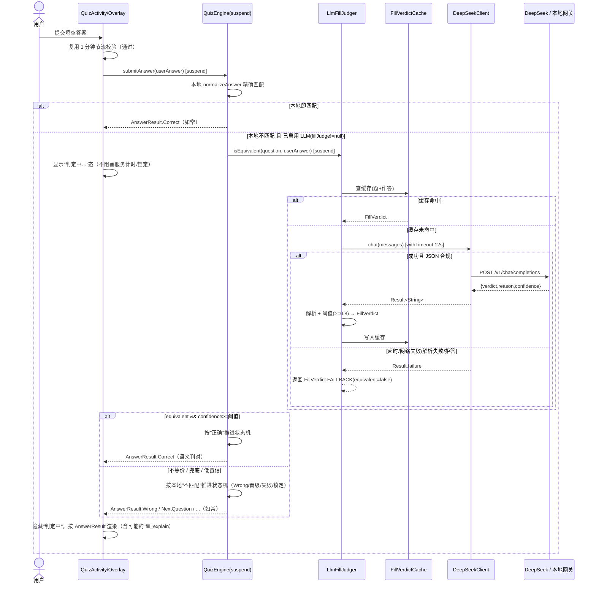
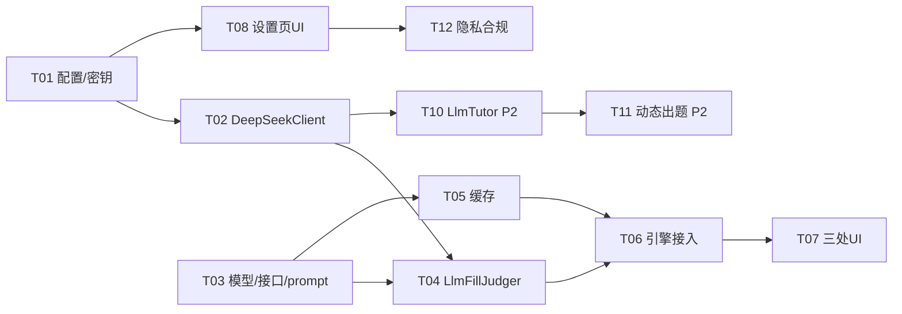

# 防沉迷学习守护 App — DeepSeek 接入设计文档

> 包名：`com.antidip` · 技术栈：纯 Kotlin + Room + coroutines（**无 OkHttp**，`HttpURLConnection` 即可联网）
> 文档定位：设计稿（**不改动任何源码 / 不改动 git 状态**），供 Engineer 按"任务分解"落地。
> 配套代码事实（已实地复核行号）：
> - `QuizEngine.kt:175-190` `checkAnswer`；`fill` 分支 `:184-187` 调 `normalizeAnswer`（`:200-213`）做去标点/空格/大小写后的**精确匹配**；`isAnswerCorrect`（`:197-198`）供练习模式。
> - `QuestionEntity.kt`：`type`("choice"/"fill")、`answer`、`content`、`options`(填空为 null)。
> - `QuizDownloader.kt`：`HttpURLConnection` + `withContext(Dispatchers.IO)`，连接 10s / 读取 30s，`finally { connection?.disconnect() }`，返回 `kotlin.Result<T>`，先经 `UrlValidator.isAcceptable`。
> - `UrlValidator.kt:61-69`：`https` 一律放行；`http` 仅限私网/本机 → `https://api.deepseek.com` 天然通过；本地 Ollama（`http://192.168.x` / `localhost`）也通过。
> - 密钥范式：`build.gradle.kts:13-39` 从 `local.properties` 的 `ANTI_ADDICTION_MASTER_PASSWORD` 注入 `BuildConfig.MASTER_PASSWORD`，**绝不硬编码**；DeepSeek Key 照此模式（新增 `DEEPSEEK_API_KEY`）。
> - 填空节流：`QuizActivity.kt:382-394`（常量 `FILL_SUBMIT_INTERVAL_MS=60_000`）；`QuizOverlayController.kt:385-398`；可复用为 LLM 限流。

---

## 1. 两种接入深度与推荐

| 维度 | **Phase 1 · 轻量（推荐先做）** | **Phase 2 · 重度（AI 伴学）** |
|---|---|---|
| 目标 | 用 LLM 做填空题"**语义等价判定**"，弥补本地 `normalizeAnswer` 只做精确匹配的不足 | 升级为"AI 伴学"：用 LLM 生成**错题讲解**（替代当前直接显示预设答案的 `R.string.fill_explain`），乃至**动态出题 / 对话** |
| 判定流向 | 本地匹配优先；**仅当本地判"不匹配"时**，异步调 DeepSeek 二次判定（等价/不等价）；等价→判对，否则→判错 | 同上判定，新增"判错后异步拉取讲解"，并可在练习模式用 LLM 出题 |
| 对防沉迷的影响 | **零影响**：任何失败/超时/无网都回退到本地"判错"，锁定流程不受外网左右 | 讲解/出题为**旁路增强**，不参与惩罚状态机；判分仍走 Phase 1 的本地兜底 |
| 新增代码量 | 中（客户端 + 判定器 + 缓存 + 引擎挂接 + 设置页） | 在 Phase 1 之上增加 Tutor 模块 |
| 上线建议 | **先上 Phase 1**，灰度验证可靠性与成本后再谈 Phase 2 | 视 Phase 1 的命中率/成本/隐私合规结论再决定 |

**核心原则（贯穿两阶段）**：本地 `normalizeAnswer` 永远是**第一判据且不可被外网推翻**；LLM 只是"本地不匹配时的二次宽松"，且**只有在其成功返回且置信度达标时才可能把"错"翻转为"对"**；其自身失败一律当作"不匹配"处理。防沉迷锁定**绝不依赖**外网可达性。

---

## 2. 架构与模块设计

### 2.1 网络层选型（关键取舍）

**结论：Phase 1 复用现有 `HttpURLConnection`，不引入 OkHttp。**

| 方案 | 优点 | 缺点 | 决策 |
|---|---|---|---|
| 复用 `HttpURLConnection`（推荐） | 与 `QuizDownloader` 完全一致，零新依赖、小体积、R8 简单；调用是简单 JSON POST，无需连接池 | 需手写 JSON 序列化、无自动重试/超时链 | ✅ Phase 1 采用，照抄 `QuizDownloader` 的 `try/catch/finally disconnect` 与 `Result<T>` 封装 |
| 引入 OkHttp | API 优雅、支持拦截器/重试/超时链、易做流式(SSE) | +~500KB、新增依赖、需评估 minSdk24 兼容性；本阶段无强需求 | ⏸ 仅当 Phase 2 需要**流式 reasoning token**（`deepseek-reasoner`）或复杂重试时再评估 |

> 注：`/v1/chat/completions` 支持 `stream`，但 Phase 1 判定用 `stream:false` 即可，无需 OkHttp。

### 2.2 新增模块（包 `com.antidip.llm`）

```
com.antidip.llm
├── FillVerdict.kt      // 判定结果模型（data class）
├── FillJudge.kt        // 接口：isEquivalent(question, userAnswer): FillVerdict
├── DeepSeekClient.kt   // 网络：OpenAI 兼容 /v1/chat/completions，HttpURLConnection + Result<T>
├── LlmFillJudger.kt    // 实现 FillJudge：拼 prompt → 调 client → 解析 JSON → 置信阈值 → 兜底
├── FillVerdictCache.kt // 缓存：题+作答 → verdict（内存 LRU + 持久化），复用 1 分钟节流
├── LlmConfig.kt        // 读取 LLM 配置（端点/Key/模型/开关/优先本地），封装 AppConfig 扩展
├── LlmPrompts.kt       // 严格 prompt 模板（只输出 JSON：verdict/reason/confidence）
└── LlmTutor.kt        // Phase 2：错题讲解 / 动态出题（伴学）
```

### 2.3 判定结果模型（`FillVerdict`）

```kotlin
package com.antidip.llm

/**
 * LLM 对"用户填空是否等价于标准答案"的判定。
 * 纯 Kotlin，可被 JVM 单测直接覆盖（与 QuizEngine 同风格）。
 */
data class FillVerdict(
    val equivalent: Boolean,   // true=语义等价（可判对）；false=不等价或判定失败
    val reason: String,        // 简短理由（用于"判定中/讲解"展示与日志脱敏）
    val confidence: Float      // 0.0..1.0，模型给出的置信度
) {
    companion object {
        /** 任何失败/超时/无网的统一兜底：永远判"不等价"，绝不让外网把错翻成对。 */
        val FALLBACK = FillVerdict(equivalent = false, reason = "llm_unavailable", confidence = 0f)
    }
}
```

### 2.4 判定接口（`FillJudge`）

```kotlin
interface FillJudge {
    /**
     * 判断 [userAnswer] 是否语义等价于 [question.answer]。
     * - 必须挂超时（见 DeepSeekClient 超时 + 外层 withTimeout）。
     * - 任何异常/超时/解析失败都必须返回 FillVerdict.FALLBACK（equivalent=false）。
     * - 不得抛出未捕获异常给调用方（与 QuizDownloader.Result<T> 一致）。
     */
    suspend fun isEquivalent(question: QuestionEntity, userAnswer: String): FillVerdict
}
```

### 2.5 `QuizEngine` 的 fill 分支如何"可挂接异步判定"

保持 `QuizEngine` **纯 Kotlin、无 Android 依赖、可 JVM 单测**的特质。做法：

- 新增可空属性 `var fillJudge: FillJudge? = null`（默认 `null` ⇒ 行为与今日完全一致，单测零改动）。
- 将 `submitAnswer` 升级为 **`suspend fun submitAnswer(userAnswer: String): AnswerResult`**：先跑本地 `checkAnswer`（不变）；当 `fill` 且本地不匹配 **且 `fillJudge != null` 且 LLM 已启用** 时，挂起调用 `fillJudge.isEquivalent(...)`；`equivalent && confidence >= 阈值` ⇒ 当作正确走 `Correct` 分支；否则按原本地逻辑推进状态机。
- 保留 `submitAnswerLocal(userAnswer)`（即今日 `submitAnswer` 的主体）供 `isAnswerCorrect`（练习模式，保持离线/即时、不触外网）与单测使用。
- 状态机**只在最终 verdict 确定后**才 mutate（attempts/round 递减只发生一次），因此不存在"先判错再翻对"导致的双扣或越级问题。

> 备选（若团队坚持不动引擎签名）：在 UI 层做"两阶段"——先 `submitAnswerLocal` 得本地结果，若为 fill 的 `Wrong` 再异步 `LlmFillJudger.judge` 并在回传等价时调新增的 `engine.markLastAsCorrect()` 回滚。本设计**主推"注入 FillJudge + suspend submitAnswer"**，因为"失败必回退本地错"的保证落在引擎单点，最安全，也最贴合需求原文"fill 分支改为可挂接异步判定"。

### 2.6 `DeepSeekClient`（联网，沿用 `QuizDownloader` 范式）

- 端点：`POST ${endpoint}`（`endpoint` 默认 `https://api.deepseek.com/v1/chat/completions`，可配置为本地 Ollama 的 OpenAI 兼容网关）。
- 请求头：`Content-Type: application/json`、`Authorization: Bearer ${apiKey}`（key 来自 `BuildConfig.DEEPSEEK_API_KEY` 或设置页持久化值，**绝不**写日志、绝不出现在 URL 中）。
- 请求体（OpenAI 兼容）：`{ model, messages:[{role:system,prompt},{role:user,...}], temperature:0, stream:false, response_format:{type:"json_object"} }`（DeepSeek 支持 `response_format=json_object`；本地网关若不兼容则靠 prompt 强约束 + 容错解析）。
- 超时：`LLM_CONNECT_TIMEOUT_MS=8000`、`LLM_READ_TIMEOUT_MS=15000`（整体外层再用 `withTimeout(LLM_TOTAL_TIMEOUT_MS=12000)` 兜底，确保**绝不超过 1 分钟节流且远小于惩罚流程可容忍时延**）。
- 封装：`suspend fun chat(messages): Result<String>`，内部 `withContext(Dispatchers.IO)`，全程 `try/catch`，`finally { connection?.disconnect() }`；**只记录 host，绝不记录 key/作答全文**（沿用 `QuizDownloader` "log only host" 约定）。
- 调用前经 `UrlValidator.isAcceptable(endpoint)` 校验（`https` 或私网 `http` 均可），拦截非法/公网明文 `http`。

---

## 3. 组件关系图（Mermaid）

```mermaid
flowchart TB
    subgraph UI["现有答题 UI（复用 1 分钟节流）"]
        QA["QuizActivity"]
        QO["QuizOverlayController"]
        PA["PracticeActivity（保持本地判分，离线）"]
    end

    subgraph Core["现有核心（不新增依赖）"]
        QE["QuizEngine\n（注入 FillJudge，suspend submitAnswer）"]
        QB["QuestionBankManager / Room\nQuestionEntity"]
        QDL["QuizDownloader → UrlValidator"]
        CS["QuizStateStore / AppConfig / Constants"]
        SA["SettingsActivity（新增 LLM 配置区）"]
    end

    subgraph LLM["新增 com.antidip.llm"]
        FJ["FillJudge (interface)"]
        LJ["LlmFillJudger\n(prompt + JSON 解析 + 阈值 + 兜底)"]
        DC["DeepSeekClient\n(HttpURLConnection + Result<T>)"]
        FC["FillVerdictCache\n(内存LRU + 持久化)"]
        LT["LlmTutor（Phase 2 讲解/出题）"]
        LC["LlmConfig"]
    end

    subgraph Net["外部 / 可选"]
        DS["DeepSeek API\nhttps://api.deepseek.com"]
        OL["本地 Ollama 网关\nhttp://192.168.x / localhost（数据不出 LAN）"]
    end

    QA --> QE
    QO --> QE
    PA --> QE
    QE --> QB
    QE -.fillJudge.-> FJ
    FJ <|.. LJ
    LJ --> FC
    LJ --> DC
    DC --> DS
    DC --> OL
    SA --> LC
    LC --> LJ
    LC --> DC
    LT --> DC
    QDL -.复用范式.-> DC
    CS -.配置.-> LC
```

---

## 4. 调用时序图（Mermaid）

### 4.1 Phase 1 轻量：填空提交 → 本地匹配 → 不匹配则"判定中" → 调 DeepSeek → 回传 verdict → 更新 AnswerResult



> **失败/超时回退分支**（最关键）：`DC` 任意失败 ⇒ `LJ` 永远返回 `FALLBACK(equivalent=false)` ⇒ 引擎按本地"不匹配"继续 ⇒ **锁定流程照常、绝不因外网而放行**。外层 `withTimeout(12s)` 保证"判定中"不会无限挂起。

---

## 5. 风险与对策（逐条覆盖需求 #5）

| # | 约束 | 风险场景 | 对策（设计内已落实） |
|---|---|---|---|
| 1 | **离线/超时强制回退** | 无网、API 限流、网关宕机、响应慢 | `FillVerdict.FALLBACK` 统一兜底；`DeepSeekClient` 连接 8s/读取 15s + 外层 `withTimeout(12s)`；任何失败 ⇒ 本地判错，锁定流程不受影响。**LLM 永远只能把"错"翻成"对"，不能把"失败"翻成"放行"。** |
| 2 | **延迟不阻塞惩罚状态机** | LLM 慢导致 UI 卡死、服务计时错乱 | `submitAnswer` 为 `suspend`，UI 在 `lifecycleScope.launch` 中调用并即时切到"判定中"态；`ScreenMonitorService` 的等待计时与锁逻辑完全独立，不依赖 LLM 返回。 |
| 3 | **成本控制** | 每次填空都打 API，费用爆炸 | ① `FillVerdictCache` 按 `hash(题ID+归一化作答)` 缓存 verdict（内存 LRU + 持久化，`LLM_JUDGE_CACHE_MAX=200`）；② 复用既有 1 分钟填空节流（`FILL_SUBMIT_INTERVAL_MS`）天然限流；③ 仅本地不匹配才触发 LLM（本地能判对的 0 调用）；④ Phase 2 讲解仅在"第三次错"时按需拉取。 |
| 4 | **隐私（儿童作答发公网）** | 儿童自由文本经公网 LLM；DeepSeek 默认可能用数据训练 | ① 设置页**家长同意开关**（默认关闭），启用前强制家长确认"数据将离开本机"；② 优先推荐**家长 PC 本地跑 Ollama 网关**（`http://192.168.x` / `localhost`，`UrlValidator` 已放行，数据不出 LAN）；③ 如用 DeepSeek 公网，建议关闭训练/用企业版（账户级），并在文档中标注需核实；④ 仅发送"题目 + 标准答案 + 用户作答"，不发送任何儿童身份/设备标识。 |
| 5 | **可靠性** | 模型不吐 JSON、拒答、幻觉、低置信 | ① 严格 prompt（`LlmPrompts`）：要求**只输出 JSON** `{verdict:bool, reason:str, confidence:float}`，`temperature:0`，`response_format=json_object`；② **置信阈值** `LLM_CONFIDENCE_THRESHOLD=0.8`，低于阈值按不匹配；③ 解析失败/字段缺失 ⇒ `FALLBACK`；④ 用本地预设答案兜底展示（`R.string.fill_explain`），不依赖 LLM 讲解。 |
| 6 | **密钥安全** | Key 硬编码/进日志/被 R8 提取 | ① 注入范式同 `MASTER_PASSWORD`：`local.properties` → `BuildConfig.DEEPSEEK_API_KEY`；② 允许设置页**家长门控**配置 Key（存 `EncryptedSharedPreferences` 优于明文，已在决策清单标注）；③ **绝不**打印 key/全文到 `Log`；④ 明确告知：R8/混淆**不能隐藏** `BuildConfig` 字符串，故发布版不建议内置高价值 key，优先"本地 Ollama/家长运行时填写"。 |

---

## 6. 文件清单（新建 / 修改）

### 新建
| 路径 | 作用 |
|---|---|
| `app/src/main/java/com/antidip/llm/FillVerdict.kt` | 判定结果模型（含 `FALLBACK`） |
| `app/src/main/java/com/antidip/llm/FillJudge.kt` | 判定接口 |
| `app/src/main/java/com/antidip/llm/DeepSeekClient.kt` | OpenAI 兼容网络客户端（`HttpURLConnection`+`Result<T>`，复用 `QuizDownloader` 范式） |
| `app/src/main/java/com/antidip/llm/LlmFillJudger.kt` | `FillJudge` 实现：prompt→调用→解析→阈值→兜底 |
| `app/src/main/java/com/antidip/llm/FillVerdictCache.kt` | 判定缓存（内存 LRU + 持久化，复用节流） |
| `app/src/main/java/com/antidip/llm/LlmConfig.kt` | 读取 LLM 配置（端点/Key/模型/开关/优先本地） |
| `app/src/main/java/com/antidip/llm/LlmPrompts.kt` | 严格 JSON prompt 模板 |
| `app/src/main/java/com/antidip/llm/LlmTutor.kt` | **Phase 2**：错题讲解 / 动态出题 |
| `app/src/test/java/com/antidip/llm/LlmFillJudgerTest.kt` | 单测：JSON 解析、超时/失败兜底、缓存命中、阈值边界 |
| `app/src/main/res/values/strings_llm.xml` | 新增字符串：`判定中…`、设置页标签、家长同意文案 |

### 修改
| 路径 | 改动要点 |
|---|---|
| `app/src/main/java/com/antidip/QuizEngine.kt` | 新增 `fillJudge: FillJudge?`；`submitAnswer` 改为 `suspend` 并接入 LLM 二次判定；保留 `submitAnswerLocal` 供 `isAnswerCorrect`/单测 |
| `app/src/main/java/com/antidip/ui/QuizActivity.kt` | `submitAnswer` 调用包进 `lifecycleScope.launch`；新增"判定中"态 UI；注入 `LlmFillJudger`；复用 `FILL_SUBMIT_INTERVAL_MS` 限流 |
| `app/src/main/java/com/antidip/ui/QuizOverlayController.kt` | 同 `QuizActivity`（悬浮窗路径） |
| `app/src/main/java/com/antidip/ui/PracticeActivity.kt` | **默认保持本地判分（离线即时）**；Phase 2 可选接入 `LlmTutor` 讲解 |
| `app/src/main/java/com/antidip/Constants.kt` | 新增 LLM 配置常量（见 §8） |
| `app/src/main/java/com/antidip/AppConfig.kt` | 新增 LLM 配置读写（endpoint/key/model/enabled/preferLocal） |
| `app/src/main/java/com/antidip/ui/SettingsActivity.kt` + 其布局 | 新增"AI 判分(LLM)"配置区：开关 / 端点 / Key(密码框) / 模型 / 优先本地 / 家长同意，均**家长门控**保存 |
| `app/build.gradle.kts` | 新增 `DEEPSEEK_API_KEY` → `BuildConfig`（同 `MASTER_PASSWORD`）；补 `proguard-rules.pro` 备注 |
| `local.properties`（gitignored） | 文档说明新增 `DEEPSEEK_API_KEY=`（不入库） |
| `app/proguard-rules.pro` | 备注：R8 无法隐藏 `BuildConfig` 字符串，发布版勿内置高价值 key |

---

## 7. 任务分解（有序 · 含依赖 · 区分 Phase）

> 约定：P0 必做、P1 强烈建议、P2 可选。T 按实现顺序排列；Phase 1 可独立交付，Phase 2 建立在 Phase 1 之上。

| ID | 任务 | 阶段 | 源文件（新建/修改） | 依赖 | 优先级 |
|---|---|---|---|---|---|
| T01 | **配置与密钥基建**：`Constants` 新增 LLM 常量；`AppConfig` 新增读写；`build.gradle.kts` 注入 `BuildConfig.DEEPSEEK_API_KEY`；写 `local.properties` 说明 | P1 | Constants.kt, AppConfig.kt, build.gradle.kts | — | P0 |
| T02 | **DeepSeekClient 网络客户端**：`HttpURLConnection` + `Result<T>` + `finally disconnect` + 双重超时 + `withTimeout` + `UrlValidator` 校验 + 仅记 host | P1 | DeepSeekClient.kt（新） | T01 | P0 |
| T03 | **判定模型与接口**：`FillVerdict`(含 `FALLBACK`)、`FillJudge` 接口、`LlmPrompts` 严格 JSON prompt | P1 | FillVerdict.kt, FillJudge.kt, LlmPrompts.kt（新） | — | P0 |
| T04 | **LlmFillJudger 实现**：拼 prompt→调 client→解析 JSON→阈值→`FALLBACK` 兜底；接 `LlmConfig` | P1 | LlmFillJudger.kt（新） | T02, T03 | P0 |
| T05 | **FillVerdictCache 缓存**：内存 LRU + 持久化，键=`hash(题ID+归一化作答)`，上限 `LLM_JUDGE_CACHE_MAX` | P1 | FillVerdictCache.kt（新） | T03 | P1 |
| T06 | **QuizEngine 接入异步判定**：注入 `fillJudge`；`submitAnswer` 改 `suspend`（本地优先→LLM 二次）；保留 `submitAnswerLocal`；状态机只在最终 verdict 后 mutate | P1 | QuizEngine.kt | T04 | P0 |
| T07 | **三处 UI 接入**：`QuizActivity`/`QuizOverlayController` 包 `launch` + "判定中"态 + 注入 judger + 复用 1 分钟节流；`PracticeActivity` 保持本地 | P1 | QuizActivity.kt, QuizOverlayController.kt, PracticeActivity.kt | T06 | P0 |
| T08 | **设置页 LLM 配置 UI**：开关/端点/Key(密码框)/模型/优先本地/家长同意，全部 `ParentAuth` 门控保存 | P1 | SettingsActivity.kt + 布局, strings_llm.xml | T01 | P1 |
| T09 | **单元测试**：JSON 解析、超时/失败兜底返回 `FALLBACK`、缓存命中、阈值边界、引擎 suspend 路径 | P1 | LlmFillJudgerTest.kt（新） | T04, T05, T06 | P1 |
| T10 | **LlmTutor（Phase 2）**：错题讲解生成，替代 `R.string.fill_explain`；仅在"第三次错"按需拉取 | P2 | LlmTutor.kt（新）, PracticeActivity.kt（可选） | T02 | P2 |
| T11 | **动态出题 / 伴学对话（Phase 2，可选）**：练习模式用 LLM 按需出题 | P2 | LlmTutor.kt 扩展 | T10 | P2 |
| T12 | **隐私合规与家长同意流**：本地 Ollama 网关部署文档、企业版/关训练建议、同意文案与默认关闭 | P1→P2 | strings_llm.xml, SettingsActivity.kt, 文档 | T08 | P1 |

**依赖图（Mermaid）**



---

## 8. 依赖与配置

### 8.1 新增第三方依赖
- **Phase 1：无新增库**（沿用 `HttpURLConnection` + `kotlinx-coroutines` + `androidx.datastore` 已具备）。
- Phase 2 若需流式/SSE，再评估 `com.squareup.okhttp3:okhttp`（届时单独决策）。

### 8.2 `local.properties`（gitignored，仅文档说明，不入库）
```properties
# 已有：
ANTI_ADDICTION_MASTER_PASSWORD=...
# 新增（可选；亦可仅在设置页运行时填写，避免发布版内置 key）：
DEEPSEEK_API_KEY=sk-xxxxxxxx
```

### 8.3 `app/build.gradle.kts` 改动（仿 `MASTER_PASSWORD`）
```kotlin
val deepseekKey = localProps.getProperty("DEEPSEEK_API_KEY") ?: ""
// ...
buildConfigField("String", "DEEPSEEK_API_KEY", "\"${deepseekKey}\"")
```
> 备注：R8/混淆**无法隐藏** `BuildConfig` 字符串，发布版不建议内置高价值 key——优先"本地 Ollama / 家长运行时填写"。

### 8.4 `Constants.kt` 新增配置项
```kotlin
// LLM / DeepSeek 接入（Phase 1 轻量：语义等价判定）
const val KEY_LLM_ENABLED        = "llm_enabled"          // 是否启用 LLM 判分（默认 false）
const val KEY_LLM_ENDPOINT       = "llm_endpoint"         // API 端点
const val KEY_LLM_API_KEY        = "llm_api_key"          // 运行时 Key（EncryptedSharedPreferences）
const val KEY_LLM_MODEL          = "llm_model"            // 模型名
const val KEY_LLM_PREFER_LOCAL   = "llm_prefer_local"     // 优先本地 Ollama 网关

const val DEFAULT_LLM_ENDPOINT   = "https://api.deepseek.com/v1/chat/completions"
const val DEFAULT_LLM_MODEL      = "deepseek-chat"

const val LLM_CONNECT_TIMEOUT_MS = 8_000
const val LLM_READ_TIMEOUT_MS    = 15_000
const val LLM_TOTAL_TIMEOUT_MS   = 12_000   // 外层 withTimeout 兜底（< 1 分钟节流）
const val LLM_CONFIDENCE_THRESHOLD = 0.8f   // 低于此置信度按"不匹配"
const val LLM_JUDGE_CACHE_MAX    = 200      // 持久化缓存上限
```

### 8.5 设置页 UI 改动建议（仿现有"题库 URL"配置，均 `ParentAuth` 门控）
新增卡片"AI 判分(LLM)"：
- 开关 `swLlmEnabled`（默认关，打开即弹家长同意：数据可能离开本机）。
- 输入框 `etLlmEndpoint`（默认 `DEFAULT_LLM_ENDPOINT`，保存时 `UrlValidator.isAcceptable` 校验）。
- 密码框 `etLlmApiKey`（不回显；保存到 `EncryptedSharedPreferences`）。
- 输入框 `etLlmModel`（默认 `deepseek-chat`）。
- 开关 `swPreferLocal`（勾选则端点默认指向本地 Ollama 网关）。
- 文本：清晰说明"开启后儿童作答可能经网络 LLM；推荐家长 PC 本地 Ollama 以保护隐私"。

---

## 9. 共享约定（与现有代码一致）

- **错误封装**：沿用 `QuizDownloader` 的 `kotlin.Result<T>`；网络函数 `suspend fun ... : Result<T>`，内部 `try/catch`，`finally { connection?.disconnect() }`，失败时返回 `Result.failure` **不抛给调用方**。
- **协程**：网络在 `withContext(Dispatchers.IO)`；UI 调用用 `lifecycleScope.launch`（Activity）或 `CoroutineScope(SupervisorJob()+Dispatchers.Main)`（Overlay）；外层 `withTimeout(LLM_TOTAL_TIMEOUT_MS)` 防挂起。
- **日志**：纯模块（`QuizEngine`、`FillVerdict`、`FillJudge`、`LlmFillJudger` 核心逻辑）**不依赖 `android.util.Log`**，可在 JVM 单测覆盖；客户端仅 `Log.w/e` 且**只记 host、绝不记 key/作答全文**（仿 `QuizDownloader` "log only host"）。
- **命名**：新类 `Llm*` / `Fill*` 前缀；常量集中 `Constants.kt`；每个类 `companion object { const val TAG }`。
- **配置集中**：所有跨模块字面量（key/默认值/超时）进 `Constants` + `AppConfig`，不散落。
- **本地优先 & 回退**：任何外部依赖失败都回到既有的本地行为（`normalizeAnswer` / `R.string.fill_explain`），保证防沉迷确定性。

---

## 10. 待用户决策事项（Decision List）

1. **接入深度**：先只做 Phase 1（轻量语义判定），还是直接规划 Phase 2（AI 伴学/讲解/动态出题）？→ 本文**推荐先做 Phase 1**。
2. **API Key 来源**（三选一或组合）：
   - (a) 构建期注入 `local.properties` → `BuildConfig`（简单，但发布版 key 可被提取，不推荐高价值场景）；
   - (b) 设置页家长门控运行时填写（存 `EncryptedSharedPreferences`，推荐）；
   - (c) 完全不连公网，仅用**家长 PC 本地 Ollama 网关**（隐私最佳，推荐默认引导）。
3. **是否现在就实现轻量版**：建议本次即落地 T01–T09（Phase 1），T10–T12 视验证结论排期。
4. **引擎改造方式**：接受"注入 `FillJudge` + `submitAnswer` 改 `suspend`"（主推），还是需要"UI 两阶段、引擎零签名改动"的备选？
5. **第三次错的语义翻盘**：Phase 1 是否允许在"第三次错（已晋级/失败/锁定）"时仍把 LLM 等价判定回滚为正确？→ 为锁定流程确定性，**建议仅在前两次 `Wrong`（仍有尝试次数）时应用 LLM 翻盘**，第三次错不回滚（讲解仍可由 Phase 2 提供）。需确认。
6. **隐私合规红线**：是否要求默认关闭、家长显式同意且提供本地 Ollama 方案？→ 建议"是"。
7. **本地 Ollama 端点形态**：家长侧用什么 OpenAI 兼容网关（Ollama 原生 `/api/chat` 需兼容层；或 `litellm`/内置 `/v1`）？需明确以便 `DeepSeekClient` 兼容配置（本文按 OpenAI 兼容 `/v1/chat/completions` 设计，可配置 base）。

---

## 11. 核心方案与下一步（摘要）

- **方案核心**：保持 `normalizeAnswer` 本地精确匹配为唯一不可推翻的第一判据；仅当本地"不匹配"且已启用 LLM 时，异步（挂 `suspend` + "判定中"态）调 DeepSeek 做语义等价二次判定，**等价且高置信才判对**，否则按本地错推进；**任何失败/超时/无网统一回退本地错**，锁定流程绝不依赖外网。
- **架构落点**：新增 `com.antidip.llm`（`FillVerdict`/`FillJudge`/`DeepSeekClient`/`LlmFillJudger`/`FillVerdictCache`/`LlmConfig`/`LlmPrompts`，Phase 2 加 `LlmTutor`）；`QuizEngine` 注入 `FillJudge`、改 `suspend submitAnswer`；三处 UI 接入"判定中"态并复用 1 分钟节流；网络沿用 `HttpURLConnection` 不引 OkHttp。
- **关键风险**：①离线/超时回退（已用 `FALLBACK`+双重超时+`withTimeout` 锁死）；②儿童作答隐私（默认关、家长同意、推本地 Ollama）；③成本（缓存 + 仅本地不匹配才调 + 节流）；④密钥（构建注入 + 运行时加密存储 + 不打印 + R8 不可隐藏的说明）；⑤可靠性（严格 JSON prompt + 置信阈值 + 拒答/幻觉兜底）。
- **下一步建议**：**先实现 Phase 1（T01–T09）**，灰度验证语义判定命中率、单次时延与费用；同时由家长侧准备"本地 Ollama 网关"方案作为隐私默认；Phase 2（`LlmTutor` 讲解/动态出题）待 Phase 1 结论后再排期。
